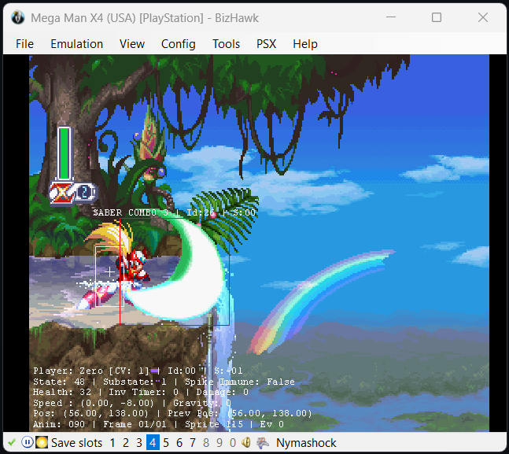
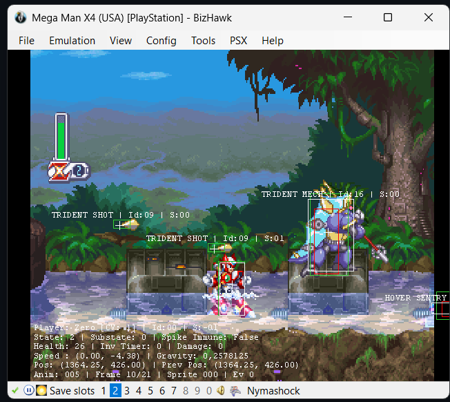
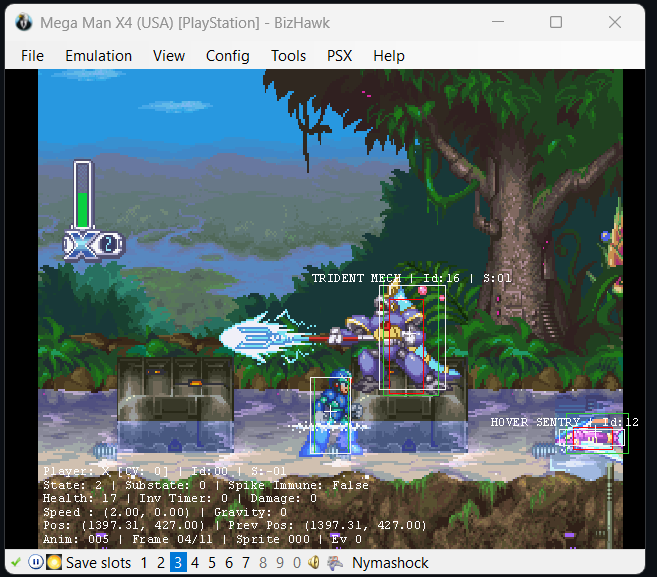
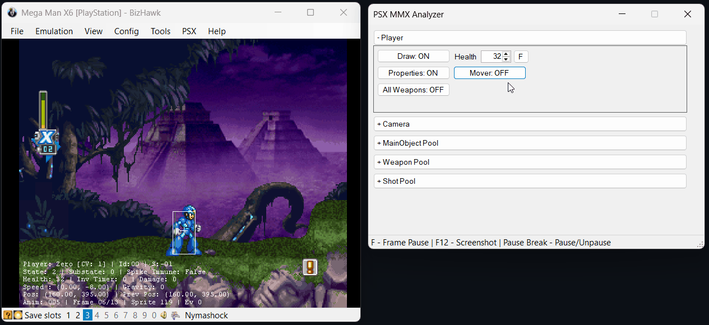
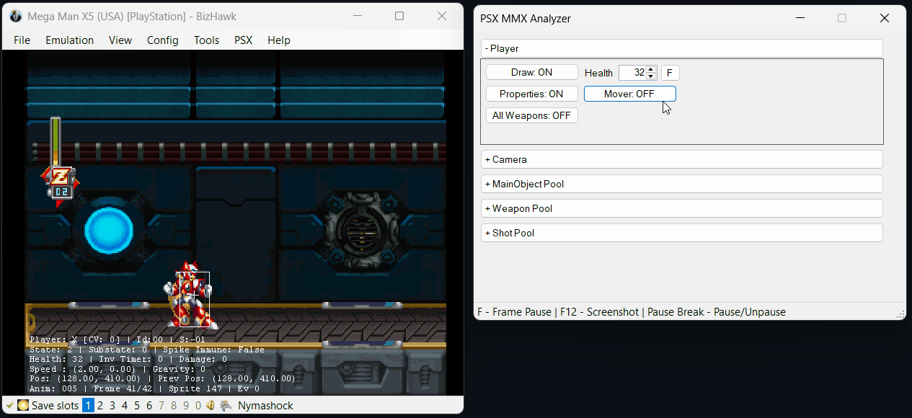
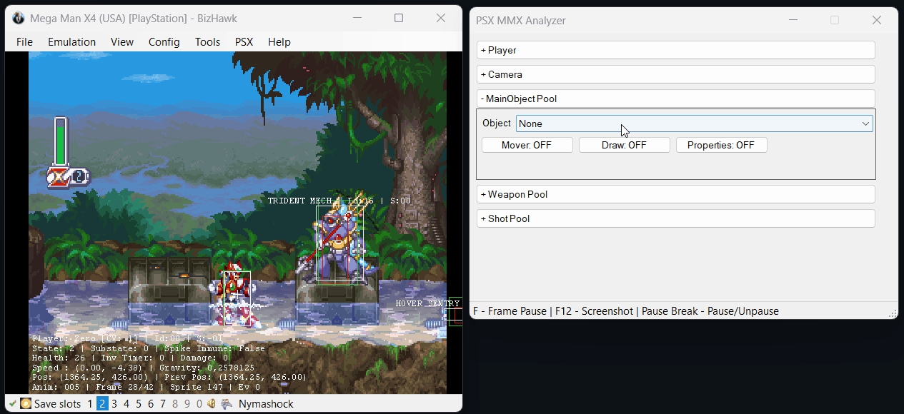
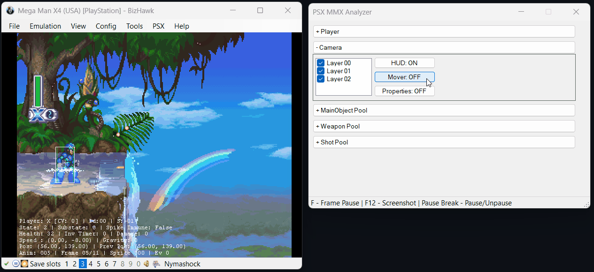
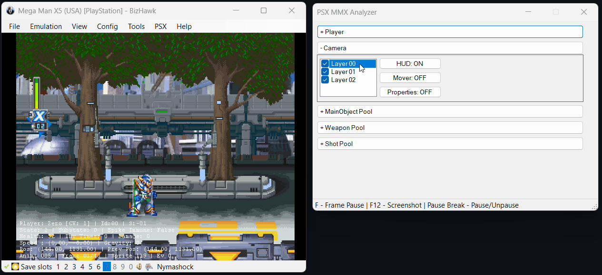

# BizHawk-PSX-MMX

A specialized BizHawk **External Tool** plugin built in C# (.NET) for **BizHawk**. It currently targets **BizHawk v2.11.1**, and this target may change as new BizHawk releases become available. The plugin is designed to inspect, monitor and analyze memory, internal states and mechanics across the USA releases of the PlayStation 1 Mega Man X trilogy:

* **Mega Man X4** (`314E06A8`)
* **Mega Man X5** (`1C64D6EA`)
* **Mega Man X6** (`F063F536`)

## Features

### Player, Enemies and Weapons/Shots

- Show the Player properties (HP, position, speed etc);
- Show the Enemy properties (HP, position, speed etc);
- Show the Axis Aligned Bounding Box (AABB) from the Player, Enemies and its weapons/shots;





AABB Colors: 
- Red: damager colliders (boxes able to inflict damage)
- Green: damageable colliders (boxes able to receive damage)
- White: stage collision boxes

Free Player Movement:



Freeze Player movement is a good way for collecting animation references:



You can also free move any enemy!



### Camera

Free Camera control:



Toggle Camera Layers visibility:




## Development

- Consult the [C# style guide](docs/csharp-style-guide.md) before changing source code.

### Prerequisites

- [BizHawk v2.11.1](https://github.com/TASEmulators/BizHawk/releases/tag/2.11.1) — currently supported version; newer releases may be adopted after compatibility is verified
- A .NET SDK supported by the C# Dev Kit extension
- Visual Studio Code with the C# Dev Kit extension
- A legally obtained USA PSX game image from the supported Mega Man X trilogy

The project targets .NET Framework 4.8 and restores the required reference assemblies through NuGet.

### Setup

1. Clone this repository.
2. Install BizHawk v2.11.1.
3. Open the repository folder in Visual Studio Code.
4. By default, place the current BizHawk installation in the sibling `2.11.1` folder. The project resolves references from it automatically. When the supported version changes, update this folder name and the `BizHawk_Version` property in `src/BizHawkPSXMMX.csproj`.

If BizHawk is installed elsewhere, set `BizHawk_Home` when running MSBuild:

```powershell
dotnet msbuild src\BizHawkPSXMMX.csproj -restore -target:LaunchBizHawk -property:BizHawk_Home="D:\Emulators\BizHawk"
```

To launch a ROM during development, add `-property:RomPath="D:\Games\game.cue"` to the command.

When changing game memory, compare the implementation with the matching-decompilation sources for the target USA release:

- [Mega Man X4](https://github.com/HyagoOliveira/mmx4)
- [Mega Man X5](https://github.com/HyagoOliveira/mmx5)
- [Mega Man X6](https://github.com/HyagoOliveira/mmx6)

Keep game-specific addresses and layouts separate and document verified findings in [PSX Game Memory Reference](docs/reference/psx-memory-reference.md). Do not commit extracted ROM or disc data.

### Build

Press `Ctrl+Shift+B` to build, deploy the tool, and launch BizHawk in one step. VS Code prompts for an optional ROM path; leave it blank to start without a ROM.

To compile without deploying or launching BizHawk, open the Command Palette with `Ctrl+Shift+P`, select **Tasks: Run Task**, then choose **Build only**. You can also run this command from the integrated terminal at the repository root:

```powershell
dotnet build .\src\BizHawkPSXMMX.csproj
```

The `.vscode` task list also provides:

- **BizHawk: Deploy** — builds and copies the DLL into BizHawk's `ExternalTools` folder.
- **Build, Deploy and Launch** — the default build task, which runs all steps above.

Before deployment, the workflow closes the `EmuHawk.exe` instance from the configured BizHawk installation. It first requests a normal shutdown and waits up to 10 seconds; if the emulator does not close, it forcefully stops that process so the DLL can be replaced. Other BizHawk installations are not affected.

### Research

- Memory addresses and reconstructed layouts are tracked in [PSX Game Memory Reference](docs/reference/psx-memory-reference.md).
- The repository currently uses the BizHawk v2.11.1 API and the matching decompilation repositories for Mega Man X4, X5, and X6 as implementation references. API contracts should be rechecked whenever the target BizHawk version changes.

## License

This project is licensed under the MIT License - see the LICENSE file for details.